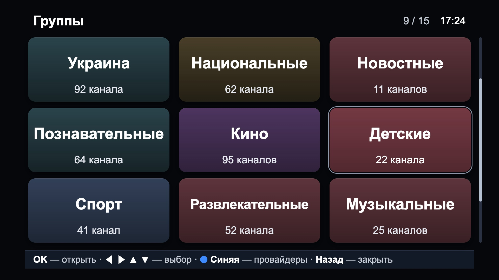
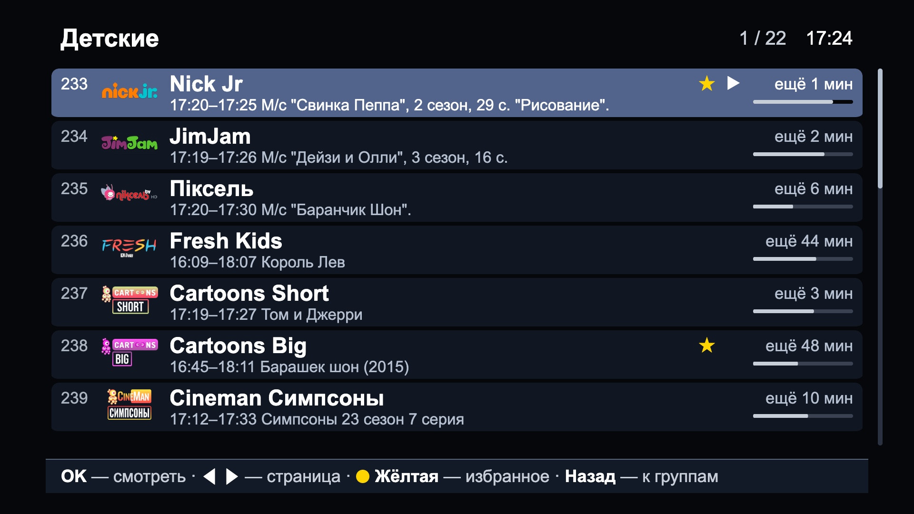
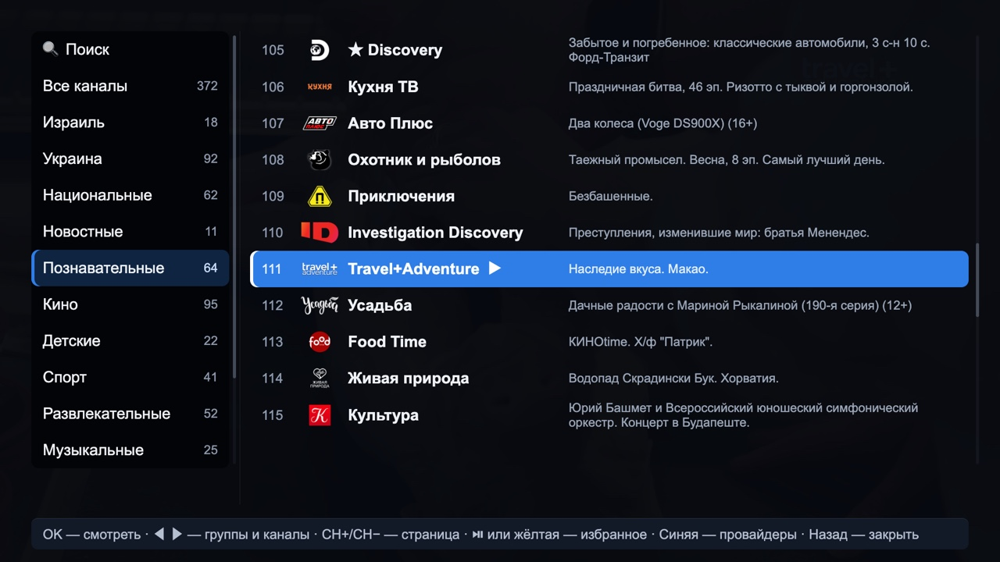
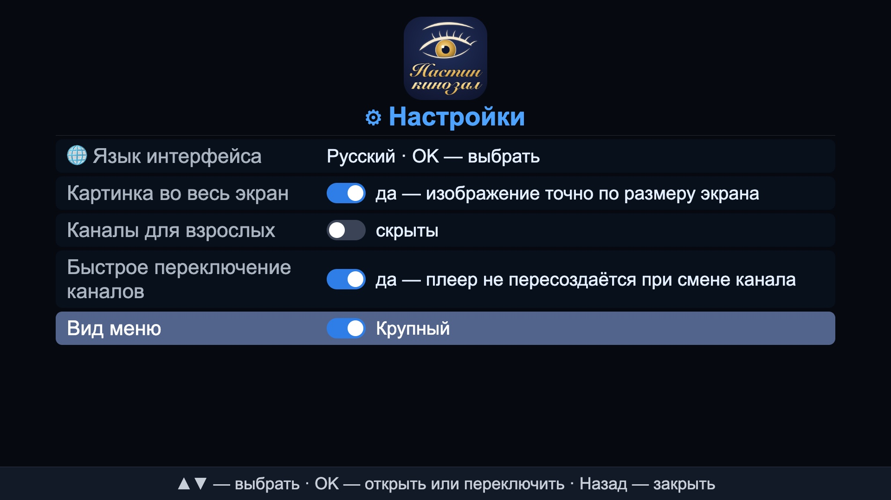
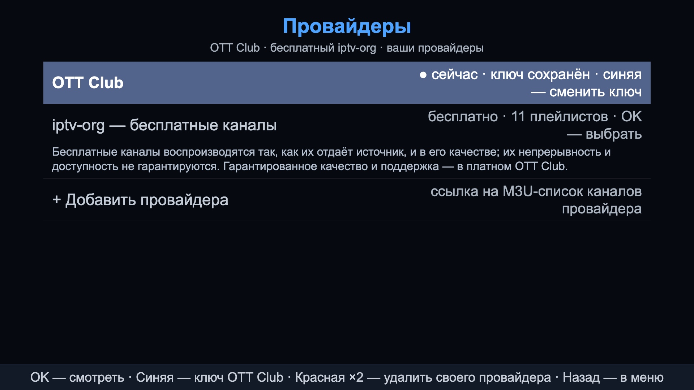
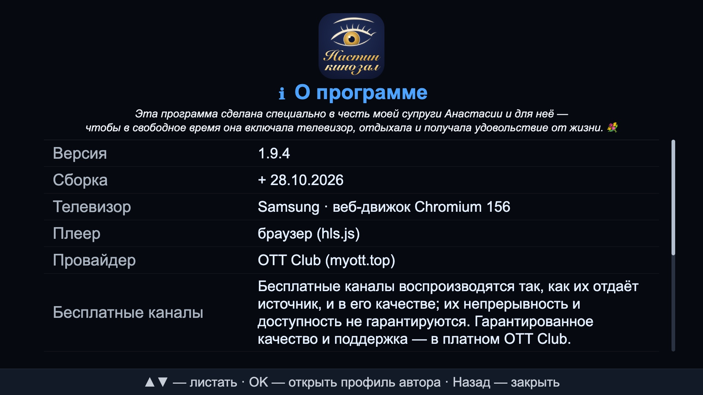

<p align="center">
  
</p>

<h1 align="center">Настин кинозал · Nastin Kinozal</h1>

<p align="center">
  <b>Your old Samsung TV deserves a cinema that never freezes.</b><br>
  <b>A fast, modern IPTV player for the Samsung TV you already own — even a 2017 one.</b><br>
  Free channels from the first minute · your own playlists · OTT Club with a 7‑day archive · four interface languages.
</p>

<p align="center">
  
  
  <br>
  
  
  <br>
  
  
  
  
</p>

<p align="center">
  
</p>

<p align="center">
  <i>💐 Dedicated to my wife, Anastasia —<br>
  so that in her free time she can switch on the TV, rest, enjoy life and simply have a wonderful time.</i>
</p>

## See it in action

<table>
  <tr>
    <td></td>
    <td></td>
  </tr>
  <tr><td align="center"><b>Large menu · groups</b>: big cards, easy to read from the sofa, made for low vision</td><td align="center"><b>Large menu · channels</b>: real logos, what's on now, minutes left, ★ favourites, ▶ playing</td></tr>
  <tr>
    <td></td>
    <td></td>
  </tr>
  <tr><td align="center"><b>Detailed menu</b>: groups and channels side by side, with real logos and what's on now</td><td align="center"><b>🔍 Search</b>: results as you type</td></tr>
</table>

<table>
  <tr>
    <td></td>
    <td></td>
    <td></td>
  </tr>
  <tr><td align="center"><b>⚙ Settings</b>: pick the large or the detailed menu, language, picture</td><td align="center"><b>📡 Providers</b>: OTT Club, free channels, your own playlists</td><td align="center"><b>ℹ About</b>: version, provider and what free channels promise</td></tr>
</table>

<table>
  <tr>
    <td></td>
    <td></td>
  </tr>
  <tr><td align="center"><b>▲ Archive slider</b>: scrub to any minute</td><td align="center"><b>▼ Programme guide</b>: past shows play from the archive</td></tr>
  <tr>
    <td></td>
    <td></td>
  </tr>
  <tr><td align="center"><b>Nat Geo Wild</b> · full HD</td><td align="center"><b>Discovery</b> · documentary</td></tr>
  <tr>
    <td></td>
    <td></td>
  </tr>
  <tr><td align="center"><b>Channel 9</b> · Israel</td><td align="center"><b>М1</b> · Ukrainian music</td></tr>
  <tr>
    <td></td>
    <td></td>
  </tr>
  <tr><td align="center"><b>Cartoons 90</b> · cartoons of the 90s</td><td align="center"><b>Cartoons Short</b> · classic animation</td></tr>
</table>

<sub>The interface screenshots show the default Russian interface with real OTT Club channels. The menu and service screens of 1.9.4 were taken in the desktop preview, so <b>ℹ About</b> shows the browser player; on the TV it shows the TV model and its hardware player.</sub>

---

## The pitch

That 2017 Samsung on your wall still has a great panel. Its apps don't: menus throw JavaScript errors, channels freeze, and nothing is updated any more. Samsung's firmware is locked, so the TV's web engine will never be upgraded.

**Настин кинозал is written for the engine your TV actually has.** It plays through the TV's own hardware decoder, comes with free channels ready to watch, speaks your language, and was measured on a real 2017 TV at every release.

**[⬇ Install it](#-install) · [⭐ Star the repo](https://github.com/yaroslavrudenko/nastin-kinozal) · [💬 Tell us your TV model](https://github.com/yaroslavrudenko/nastin-kinozal/issues)**

## Why you'll want it

| | |
|---|---|
| 🎞 **Hardware video playback** | Every stream is decoded by the TV's own hardware player, **Samsung AVPlay**, not by JavaScript: full HD (1920×1080) on a 2017 TV without straining its processor. The picture is laid exactly over the whole screen. A plain HTML `<video>` is used only off the TV, for desktop checks. |
| 🩺 **Playback that heals itself** | A watchdog checks the stream every second. A picture that stops moving for 8 s, or buffering that makes no progress for 15 s, reconnects by itself with backoff (0.5 s up to 15 s), with a 10‑second buffer to resume from. If another app borrowed the TV's player, ours is reopened; on TVs that report network changes, playback also reconnects the moment the network comes back. You never have to restart the app. |
| ⚡ **Fast** | Measured on a 2017 TV: a channel switch takes **about 1.0 s** from key to picture; menu keys answer in **37–49 ms**; channel logos never pop in while you scroll; scrolling is smoother than in 1.8.4 (long frames when holding ▼: **15 → 2**). [The numbers ↓](#-performance-what-improved-and-why) |
| 🧊 **The screen never freezes** | Lists are virtualised, so a 1000‑channel playlist moves like a 10‑channel one. Playlists and programme guides are parsed in slices of at most 8 ms, and no logo download ever starts inside a key press, so the remote keeps answering. |
| 🎬 **Calm picture, no spinner nagging** | The big buffering spinner appears only when a channel is really slow (over ~1.6 s): **0–1 times in 16 channel changes** on the TV. Quality adapts to your connection: it starts at the best the bandwidth allows and steps down rather than stalling. |
| 📺 **Runs on old TVs** | Built for Samsung Tizen 3.0 — the 2017 TVs and their Chromium 47 web engine. The whole app is plain ES5 (checked with `acorn --ecma5`), with no framework, no build step and no modern JavaScript that an old TV cannot run. Developed and measured on a Samsung UE50MU7000 from 2017. |
| ⏪ **TV you can rewind** | Up to **7 days of archive** (with OTT Club or a playlist that has catch‑up): a timeline slider to scrub to any minute, ▲ ▼ to jump between programmes, and a programme guide where past shows play from the archive. |
| 🔄 **Always current** | Channel lists and groups are fetched again every hour and always applied. With the menu open, the "now on air" lines are re‑read every minute; in every TV check they matched the guide (**13 of 13 rows, 0 stale**). |
| 🆓 **Free channels from the first minute** | The free provider **iptv-org** is built in with **11 ready playlists** — about 11 000 public channels from around the world. No key, no sign‑up. Their quality and availability are the sources' own ([about the free channels](#-start-watching--free-in-a-minute)); for guaranteed quality and support, use the paid OTT Club. |
| 📡 **Any provider, many at once** | Add as many providers' M3U links as you like on the TV and switch between them in **📡 Providers**, or enter your **OTT Club** key for 389 channels, the full guide and the 7‑day archive. Each provider remembers its last channel and group. |
| 🌍 **Four languages, Hebrew right to left** | The whole interface in **Russian, Ukrainian, Hebrew** (the full layout mirrored) or **English**. Channel names and programmes stay exactly as your provider writes them, in any script. |
| 🔒 **Private by design** | No account, no ads, no analytics. The app asks the TV for only three permissions (internet, the remote, opening a link). Its diagnostics stay on the TV. Your OTT Club key is only ever sent to OTT Club. |
| 🔬 **Measured, not promised** | Every release is measured on a real 2017 TV, and the raw logs are committed next to the scripts that produced them. Behind every fix: an automated test, a mutation proof and independent reviewers. [How it is tested ↓](#-testing) |

## What makes it different

| Design choice | What it means for you | Where it lives |
|---|---|---|
| **The TV's hardware player first** | Smooth full‑HD video on a TV whose web engine is from 2015 | [`js/player.js`](js/player.js), [`js/avtracks.js`](js/avtracks.js) |
| **Written for the engine the TV really has** | No JavaScript errors, no blank menus: everything ships inside the app, nothing is downloaded and run from a server | [`index.html`](index.html), plain ES5 in [`js/`](js/) |
| **A watchdog on every stream** | Stalls, errors and network drops are healed by themselves | [`js/player.js`](js/player.js), [`js/config.js`](js/config.js) |
| **Nothing blocks a key** | Reading a playlist or a programme guide of up to 30 MB never holds the screen for more than 8 ms at a time; a cursor move rewrites two rows, not the whole list | [`js/m3u.js`](js/m3u.js), [`js/xmltv.js`](js/xmltv.js), [`js/listview.js`](js/listview.js), [`js/listrows.js`](js/listrows.js) |
| **Freshness over caching** | Lists at most an hour old, "now on air" at most a minute old with the menu open; no cache that could show you an old list | [docs/PERFORMANCE.md](docs/PERFORMANCE.md) |
| **One transport, every request abortable** | Zapping through ten channels does not download ten guides: only the channel you stop on is loaded | [`js/net.js`](js/net.js), [`js/zap.js`](js/zap.js) |
| **Any provider, any catch‑up format** | OTT Club's API, any extended M3U with `default`, `append`, `shift` or `flussonic` archives, and the free iptv-org lists | [`js/catchup.js`](js/catchup.js), [`js/m3u.js`](js/m3u.js), [`js/ottclub.js`](js/ottclub.js) |
| **Israel and Ukraine with any provider** | A channel's country is recognised from its name, group, guide id or the language of its programmes | [`js/country.js`](js/country.js) |
| **Evidence in the repository** | Every number on this page can be checked against a raw TV log | [docs/measurements/](docs/measurements/) |

**Compared with the official OTT Club app on the same TVs:**

| | Official OTT Club app on 2017 Samsung TVs | Настин кинозал |
|---|---|---|
| Version on the TV | stuck at 1.0.6 | 1.9.3, measured on a 2017 TV at every release |
| Where the menu code comes from | a 56 KB shell downloads it from the provider's server, in JavaScript the TV's engine cannot run | shipped inside the app, plain ES5 for Chromium 47 |
| What the viewer sees | errors in the menus, frozen screens, channels that hang | 0 freezes across four OTT Club groups; 203 of 203 channel changes reached a moving picture |
[Why this project exists ↓](#why-this-project-exists)

## Measured, not promised

| Check | Result | Measured |
|---|---|---|
| The heaviest movie channel, Viju+ Megahit (1920×1080 · H.264 · 10.9 Mbit/s), 10 minutes | PLAYING in 60 of 60 samples, 0 rebuffers, 0 frozen samples | TV · [TESTING.md](docs/TESTING.md) |
| One channel for 90 s | PLAYING in 360 of 360 samples, no spinner while watching | TV · [1.9.0](docs/measurements/2026-10-28-tv-1.9.0/README.md) |
| Three movie channels, 10 minutes each, in parallel | 0 stalls · 0 rebuffers · 0 reconnects · buffer never below 12 s | desktop soak · [PERFORMANCE.md](docs/PERFORMANCE.md) |
| Channel switch, key → picture | **984 ms** median | TV · [1.9.1](docs/measurements/2026-10-28-tv-1.9.1/README.md) |
| 203 channel switches in a row | 203 of 203 reached a moving picture, 0 player errors, no slowdown | TV · [1.9.1](docs/measurements/2026-10-28-tv-1.9.1/README.md) |
| Archive slider, OK → playing | 1.4–1.9 s, starting 0 / −1 s from the chosen moment | TV · [1.9.0](docs/measurements/2026-10-28-tv-1.9.0/README.md) |
| The oldest end of the 7‑day archive | plays; first frame in 1020 ms | TV · [PERFORMANCE.md](docs/PERFORMANCE.md) |
| "Now on air" in every row of 11 groups | 0 empty rows | TV · [TEST-REPORT](docs/TEST-REPORT-2026-10-26.md) |
| Four OTT Club groups, every channel watched 20 s (up to 90 per group) | 0 freezes, 0 spinner while watching | TV · [1.9.0](docs/measurements/2026-10-28-tv-1.9.0/README.md) |
| The owner's life cycle: close, open, exit, reopen, and Home → another app → back, twice | passes | TV · [PERFORMANCE.md](docs/PERFORMANCE.md) |

## ✨ What's new

### 1.9.4

- **A new app icon.** A pen-drawn eye with a gold iris above «Настин кинозал» in large gold script, on night blue. The lettering is twice as large as before, so the name reads from the sofa. After installing, the TV shows it in the app list once it has been restarted (hold the power button).
- **A larger icon in ⚙ Settings and ℹ About**: 180 px instead of 72 px.
- **A large menu for low vision.** A new setting, **⚙ Settings → Menu view**, switches between **Large** («Крупный», the default) and **Detailed** («Подробный», the menu you know).
- **Large menu, channels.** OK on the picture opens the channel list of the group you are watching, on the channel you are watching. Every channel has its own band with a big logo and a big name, what is on now under it (long titles wrap, nothing is cut off), **minutes left** with the programme's progress bar under them, ★ for favourites and ▶ for the channel playing. ◀ ▶ turn pages, as CH+ / CH− do; ◀ on the first page goes back to the groups, ▶ on the last page stops.
- **Large menu, groups.** Back shows every group as a big card, three by three: one word for the name and the channel count on one line, so the eye finds both at once. **🔍 Search**, **📡 Providers**, **⚙ Settings** and **ℹ About** are cards too, and a help bar at the bottom names the keys.
- **A gentle cursor.** The focus in the large menu is a calm, soft fill, and the detailed menu's bright blue cursor is now a gentle slate too (white text at 7.2:1 contrast).
- **Larger ⚙ Settings, 📡 Providers and ℹ About** in both menus: bigger text, taller rows.
- **A scroll bar on every list**: groups, channels, the large menu's cards and list, search results, the programme guide, the language list, Settings, Providers and About.
- **The free channels say what they are.** Under the free iptv-org provider in **📡 Providers**, and in **ℹ About**, in all four languages: free channels play as their sources serve them, in their quality, with no guarantee of continuity; guaranteed quality and support come with the paid OTT Club.
- **Keys on the picture are unchanged** in both menus: ◀ ▶ change the channel, ▲ opens the archive slider, ▼ the programme guide.
- **Steadier menus.** Logos never arrive on screen after CH+ / CH− on the group cards, and after the hourly list refresh the cursor stays on the same channel.
- **Measured on the TV, 1.9.1 → 1.9.4** (detailed menu, OTT Club, 372 channels): open the menu **94 → 88 ms**; ▼ held ×30 **38.4 → 35.5 ms** per key; CH+ ×12 back **48.7 → 43.5 ms**; channel switch, key → picture **984 → 982 ms** (median of 12); **0** logos arriving on screen while scrolling the list.

### 1.9.3

- **⚙ Settings and ℹ About are two separate rows of the menu.** Settings holds only what you switch; About holds the dedication, the version, the TV and the author.

### 1.9.2

- **Logo work never delays startup:** logos are fetched only after the channel list and the first picture, so the list is ready as fast as before.
- **Paging into pages never seen before** is a little lighter on each key.

### 1.9.1

- **The big spinner stays away.** It used to appear on every channel change. Now it shows only when a channel takes longer than ~1.6 s to start: **0–1 times in 16 channel changes** on the TV.
- **Fast channel switching**, a new setting in **⚙ Settings**, on by default. The player is kept between channels: key → picture **984 ms** on the TV, and a 200‑switch soak test ran with **0 failures and no slowdown**.
- **No endless spinner on a dead channel**, and a stream in a format the TV cannot play is reported instead of being retried forever.
- **Archive near the end of a programme opens once**, not again and again.
- **No logo pop‑in at all:** while you scroll, 0 frames with logos being drawn in (1.8.4: 47–108 frames, up to 68 logos appearing on screen).

### 1.9.0

- **Four interface languages** — Russian, Ukrainian, Hebrew (right to left) and English, picked from a list in **⚙ Settings → 🌐 Interface language**.
- **Logos stay put.** The logos of the group you watch are loaded ahead in the background, so a list looks complete the moment you open it.
- **Hourly lists.** Channels and groups refresh every hour (was 6 hours). The offline copy on the TV is rewritten only when the list has really changed.
- **A welcoming first launch.** A fresh install shows **Choose what to watch**; choosing OTT Club asks for your key straight away.
- **Calmer lists.** The highlighted row no longer jumps or grows.
- **Clear naming.** The settings screen is titled **⚙ Settings**, like its row in the menu.
- **Adult channels are hidden by default.** Switch them on in **⚙ Settings → Adult channels**.
- **Every TV measurement is in the repository**, one folder per version, in [docs/measurements/](docs/measurements/).

## Everything it does

| Feature | What you get |
|---|---|
| 🔍 **Search** | Type part of a channel name or its number; results update as you type. |
| 🔢 **Channel by number** | Type up to 4 digits on the remote and the channel opens. |
| ★ **Favourites** | ⏯ (or Yellow) pins a channel. CH+ / CH− inside **★ Favourites** zaps through favourites only. Favourites are kept by channel, so they survive a change of your OTT Club key. |
| 🔢 **OTT Club's own channel order** | OTT Club channels come in the same group order, and the same order inside each group, as in the official OTT Club app (`js/order.js`). |
| 🗂 **Groups** | **All channels**, **★ Favourites**, **Israel** and **Ukraine** first, then the provider's own groups exactly as it names them, and **No group** for channels it gives none. Empty groups are not shown. |
| 🇮🇱🇺🇦 **Israel and Ukraine with any provider** | A channel's country is recognised from a tag in its name (`(Израиль)`, `IL:`, `[UA]`), its playlist group, its guide id (`.il` / `.ua`), Hebrew or Ukrainian text in its name or programme, or a list of well‑known channels (`js/country.js`). In every playlist Israeli channels open the list and Ukrainian ones follow; the Israel group is sorted by channel number. |
| 📅 **Programme guide** | ▼ while watching: today's programmes, ◀ ▶ for other days (OTT Club: 7 days back and 24 hours ahead), OK on a past show plays it from the archive. The guide loads per channel, only when you look at it. |
| ⏪ **Archive slider** | ▲ while watching: hold ◀ ▶ to scrub (faster as you hold), ▲ ▼ to jump between programmes, OK to watch from there. Nothing reloads while you scrub; OK opens the archive once, at the moment you chose (on the TV: **0 / −1 s** from the target). A recording that reaches its end continues with what follows, and an archive within 2 minutes of live simply plays live: no "no signal" in between. |
| ⏸ **Pause live TV** | ⏯ pauses any channel, live included; ⏯ again carries on from the moment you paused (from the archive after a longer pause). |
| 📺 **"Now on air" you can trust** | Every row of the menu shows what is on now. A row turns over to the next programme at its end by itself; the provider is asked only for the rows on screen. A row never goes blank: if the provider goes quiet, the last programme stays, marked **(ended HH:MM)** once it is over. |
| 🏷 **Banner** | Channel, programme on air with its time range, what comes **Next**, a progress bar and, after every channel switch, a short tech line (for example `1920×1080 · H264 · 25 fps · 7.5 Mbps · sound stereo`). While a stream connects, the banner says what is happening (**Connecting…**, **Loading video… N%**, **No signal — retry in N s**), so a black screen is never silent. |
| 🔊 **Sound and picture** | Red picks the audio track; Green cycles **Full screen → Auto → Letterbox**. |
| 🔠 **Large menu for low vision** | **⚙ Settings → Menu view → Large**: groups as big full‑screen cards, and a channel list in big type with big logos, what is on now, minutes left and a progress bar. ◀ ▶ turn its pages. |
| 🧭 **Scroll bars** | A quiet scroll bar beside every list, on every screen, shows where you are and where the list ends; lists never run into the hint bar on any screen size. |
| 💾 **Remembers you** | Each provider keeps your last channel and group; the app opens where you left off. |
| 🛡 **Survives bad networks** | Every stall, error or network drop reconnects with backoff (0.5 s up to 15 s). If the list server is down, the last list is shown and updates by itself. |
| 🔑 **Your key stays with OTT Club** | Used exactly as typed and only ever sent to OTT Club (pinned by tests). |
| 🔒 **Private** | No account, no ads, no analytics code. Three TV permissions only: internet, the remote's keys and opening the author's link (`config.xml`). The diagnostic counters are kept on the TV and never sent anywhere (`js/diag.js`). |
| 👤 **About** | **ℹ About** shows the version, build, TV model, Tizen and engine version, player, provider, channel count and buffer settings; **Author** opens the author's LinkedIn profile in the TV's browser. |

## 🆓 Start watching — free, in a minute

On the very first launch the app shows **Choose what to watch**:

| Choice | What happens |
|---|---|
| **iptv-org — free channels** | OK opens its playlists; OK on one starts it. No key, no sign‑up. |
| **OTT Club** | Asks for your key right away; Back returns to the choice. |
| **+ Add a provider** | Type or paste your provider's M3U link (`http://…` or `https://…`) and press OK. |

Back without a choice starts iptv-org's whole list. From then on the app opens on your last provider, group and channel.

**The free playlists built in** (all from the open [iptv-org](https://github.com/iptv-org/iptv) project, `js/config.js`):

| Playlist | |
|---|---|
| **The whole list — channels from around the world** | ~11 000 public channels (the default) |
| **Israel** · **Ukraine** | by country |
| **In Russian** · **In English — CNN, Bloomberg, DW, France 24, Euronews…** | by language |
| **News** · **Kids** · **Music** · **Movies** · **Documentary** · **Sports** | by category |

The player shows every channel a source lists and filters nothing — except adult channels, which stay hidden until you switch them on. A stream that does not play is the source's matter. No paid channels, keys or private playlists are included in this repository.

> ⚠️ **About the free channels.** Free channels come from public sources that nobody behind this app runs or controls. The player plays each stream **exactly as its source serves it, in the quality its source gives**. We take **no responsibility for the picture quality, the continuity or even the availability** of free channels: a free channel can be slow, stall, drop out, change or disappear at any time, and its programme guide can be inaccurate. A stall that the source causes is shown with the buffering spinner, and the player continues by itself once the data arrives (for example, BRIDGE Rock, measured on the TV on 2026‑10‑28: its server sometimes delivered a 5‑second piece in up to 9.4 s).

**➕ Add your own playlist in three steps:**
1. Press **OK** (the channel menu), then **Blue**: **📡 Providers** opens.
2. Choose **+ Add a provider** and type (or paste) the **M3U link** your provider gave you, `http://…` or `https://…`. Press **OK**.
3. It plays at once and stays in the list; switch to it, to iptv-org or to OTT Club any time. **Red twice** on it removes it. Only your own providers can be removed; the built‑in ones always stay.

**Change provider any time:** OK (channel menu) → **Blue**, or the **📡 Providers** row just above **⚙ Settings**.

| Row in 📡 Providers | OK | Other keys |
|---|---|---|
| **OTT Club** | watch it | **Blue** — enter or change the key |
| **iptv-org — free channels** | open its playlists | built in, cannot be removed |
| your own providers | watch it | **Red** twice — remove it |
| **+ Add a provider** | type an M3U link | — |

The provider you are watching is marked **● now**.

**Want quality you can rely on? Take the paid OTT Club.** [OTT Club](https://www.ottclub.tv) is built in: enter your key for **389 channels, the full programme guide and the 7‑day archive**. Compared with free channels, its picture quality is much better and the streams start faster. Reliability and uninterrupted playback are guaranteed by the paid provider itself, and OTT Club has its own **customer support**. Any other paid provider works today through its M3U link. Built‑in support like OTT Club's (key, guide and archive from the provider's API) for other providers will come if there is interest — [tell us which one](https://github.com/yaroslavrudenko/nastin-kinozal/issues).

## 🌐 Interface languages

| Language | In the list | Direction |
|---|---|---|
| Russian (default) | Русский | left to right |
| Ukrainian | Українська | left to right |
| Hebrew | עברית | **right to left — the whole layout is mirrored** |
| English | English | left to right |

**Change it:** **⚙ Settings → 🌐 Interface language → OK**. The list shows all four languages, each written in itself, the current one marked ✓. Pick one with ▲ ▼ and press OK. The app restarts in that language on the same channel and group. Back, or OK on the current language, changes nothing. The 🌐 sign leads the row, so you can find it even in a language you cannot read.

- **Translated:** everything the app writes, including the groups the app forms itself — **🔍 Search, All channels, ★ Favourites, Israel, Ukraine, No group, 📡 Providers, ⚙ Settings, ℹ About**.
- **Never translated:** the provider's group names, channel names and programme titles. They appear exactly as the provider writes them, in any interface language.
- **Mixed scripts read correctly:** a Hebrew name in an English menu, or a Latin or Cyrillic one in the Hebrew menu, keeps its own direction, wrapped lines included. Technical text (host names, picture sizes) always reads left to right.

## 🎮 Remote control

The basic Samsung Smart Remote is enough; number and colour keys are optional.

| Key | While watching | In the menu and the guide |
|---|---|---|
| ◀ ▶ | previous / next channel | switch between groups and channels |
| ▲ | archive slider | move up |
| ▼ | programme guide (◀ ▶ change the day) | move down |
| OK | channel menu with **🔍 Search** | watch (the channel on screen is not restarted) |
| ⏯ | pause / play | add or remove a favourite |
| ⏪ ⏩ | archive slider, big steps | — |
| CH+ / CH− | next / previous channel | next / previous page, or archive day |
| Back | back to live; twice to exit | close |
| 0–9 | channel number | — |
| Red · Green · Blue | audio track · picture mode · stream info | Blue: **📡 Providers** |

## ⚙ Settings

OK (channel menu) → **⚙ Settings**, the row after **📡 Providers**. ▲ ▼ choose, OK opens or switches, Back closes.

| Row | What it does | Default |
|---|---|---|
| **🌐 Interface language** | opens the list of the four languages | Русский |
| **Fast channel switching** | keeps the player between channels for faster switching | on |
| **Full-screen picture** | yes — the picture fits the screen exactly · no — the stream's own proportions | yes |
| **Adult channels** | shown in the menu · hidden | hidden |
| **Menu view** | **Large** — full‑screen group cards and a channel list in big type, for low vision · **Detailed** — groups and channels side by side | Detailed |

**ℹ About**, the last row of the groups, shows the dedication, the version, build, TV, player, provider, channels and buffer settings. **Author** opens the author's LinkedIn profile in the TV's browser.

## ⚡ Performance: what improved and why

Every number below was measured **on the TV** (Samsung UE50MU7000, Tizen 3.0, Chromium 47, OTT Club with 389 channels), unless it is marked *desktop*. The raw logs and the scenarios that produced them are in the repository: [1.8.4](docs/measurements/2026-10-27-tv-1.8.4/README.md) · [1.9.0](docs/measurements/2026-10-28-tv-1.9.0/README.md) · [1.9.1](docs/measurements/2026-10-28-tv-1.9.1/README.md).

### The story

| What you noticed | Why it happened | What we changed | Measured result |
|---|---|---|---|
| Logos appearing, vanishing and redrawing while scrolling | Logos were only requested once the cursor stopped, then many arrived at once | The page on screen, 2 pages ahead and 1 behind are requested on every key; the watched group's logos load in the background after the picture starts; each logo is kept in memory for the session and refreshed with the hourly list | Frames with logos popping in: **47–108 → 0**; logos drawn in on screen: **up to 68 → 0** |
| Jerky scrolling | Each page key wrote every row's logo several times | Each row's logo is set once per screen update, and only when it changes | Frames over 34 ms holding ▼: **15 → 2**; CH+ back: **23 → 1** |
| A spinner on every channel change | The spinner showed from the moment a stream opened until the picture moved | It shows only if the start takes longer than ~1.6 s | Spinner in 16 channel changes: **every time → 0–1** |
| Channel switching | A new player for every channel | **Fast channel switching**: the player is kept between channels | Key → picture **1063 → 984 ms**; 200 switches, **0 failures**, no slowdown |
| Lists out of date | The list was fetched every 6 hours | Every hour, and every list downloaded is applied | Lists at most 1 hour old |
| Needless storage writes | The offline copy was written even when nothing had changed | Written only when the list changed; written after the first picture, not before | **0** writes per unchanged hour; offline copy **500 KB → 44 KB** *(desktop)* |
| Slow, chatty zapping | Every ◀ ▶ downloaded a 205 KB guide, after a fixed 350 ms delay | Guides load once and only when needed; the key acts at once | Requests per 10 quick presses **20 → 3**; delay **350 → 0 ms** *(desktop)* |
| Busy when idle or failing | A failed guide was retried in a tight loop; background checks kept running | Backoff, and nothing runs while nothing changes | Failed‑guide requests in 10 min **12 007 → 5**; requests in a 10‑min pause **200 → 0** *(desktop)* |

Also from the first overhaul, where six independent reviewers raised 230 findings on v1.7.0 *(desktop, harness and headless Chrome at 6× CPU)*:
- **Startup:** the channel list is parsed once instead of twice, and no JavaScript long task over 50 ms remains (was 66–74 ms).
- **Memory:** full guides kept after visiting 100 channels **100 → 24**, with no descriptions stored.
- **A list server that is down for 30 minutes** costs 10 list requests instead of 179.
- **A malformed 8 000‑tag guide** is read in about 5 ms instead of 307 ms, and the time grows linearly.

### 1.8.4 → 1.9.0 → 1.9.1 on the TV

| Measure | 1.8.4 | 1.9.0 | 1.9.1 |
|---|---|---|---|
| Channel switch ▶ ◀, key → picture | 1063 ms | 982 ms | **984 ms** |
| Logo pop‑in while scrolling (frames) | 47–108 | — | **0** |
| Frames over 34 ms, holding ▼ | 15 | — | **2** |
| Frames over 34 ms, CH+ back | 23 | — | **1** |
| Frames over 34 ms, holding ▲ back | 11 | — | **2** |
| Open the menu, key → screen | 112 ms | — | **94 ms** |
| CH+ back, key → screen | 64 ms | — | **49 ms** |
| Group keys, key → screen | 50 ms | — | **37 ms** |
| Channel list load | 4047 ms | — | **3878 ms** |
| Channel by number (digits) | 2948 ms | — | **2842 ms** |
| Big spinner in 16 channel changes | every time | — | **0–1** |
| "Now" lines matching the guide | — | **13 / 13**, 0 stale | — |
| Four OTT Club groups, 20 s per channel | 0 freezes | 0 freezes, 0 spinner while watching | — |

"—" means the measure was not part of that run. More: [docs/PERFORMANCE.md](docs/PERFORMANCE.md).

### Our rule

Performance never costs freshness: no refresh is made rarer to look faster, and no cache is added that would show you an old list or an old "now on air" line.

## ✅ Testing

| | |
|---|---|
| **Automated tests** | **492 tests, all passing**, in 53 files: 40 behaviour suites and 13 headless‑browser layout suites. The browser suites check wrapping, paging, scroll bars, logo boxes, mixed‑direction text, the Hebrew right‑to‑left layout and both menu views. |
| **Mutation‑proven fixes** | For every fix, the guard is removed and the test must turn red, then the guard is restored and it must turn green again. |
| **Independent reviews** | Every batch is reviewed by people who did not write it: a native code reviewer, Codex as an external reviewer, and a performance analyst (plus a designer for layout). The first full review raised 230 findings, and every one was given a status. |
| **On the real TV** | Every release is measured on a 2017 UE50MU7000. The scenarios drive the app with remote key events through its inspector and read the results inside the TV page, on one clock. The raw logs are committed next to each scenario. |
| **Acceptance plan** | The viewer's basic journey in every group, plus a matrix covering every channel, the high‑bitrate movie channels, Israel and Ukraine HD, long names and archives across midnight: [docs/TESTING.md](docs/TESTING.md). |

Highlights from the TV:
- **0 stalls, 0 rebuffers and 0 reconnects** across three movie channels watched for 10 minutes each *(desktop soak; on the TV, Viju+ Megahit at 10.9 Mbit/s played 10 minutes with 0 rebuffers)*.
- **0 freezes** across four OTT Club groups, watching each channel for 20 s (up to 90 channels per group).
- **8 of 8** archive opens on the heaviest movie channels played.
- **0 failures** in 200 channel switches with **Fast channel switching** (203 of 203 reached a moving picture, with no slowdown from the first quarter to the last).
- **360 of 360** samples PLAYING across 90 s on one channel, with no spinner while watching.
- **The archive opens where you aimed:** the slider's start was 0 / −1 s from the chosen moment.
- **"Now on air" turned over** to the next programme within 75 s of its start, in every run that crossed a programme change.

## 📡 Your own playlists, in depth

Add any provider's **M3U link** in **📡 Providers → + Add a provider**, or build it in with `PLAYLIST_URL=` in `build.local.env`, because typing a long URL with a remote is slow. A link that carries the provider's own key (`…/playlist/<key>/…`, `?key=…`, `get.php?username=…&password=…`) is used as it is. From an extended M3U the player reads:

| Playlist attribute | What it gives you |
|---|---|
| `group-title` / `#EXTGRP` | the groups in the menu |
| `tvg-logo`, `tvg-id` | logos; programme guide matching |
| `url-tvg` / `x-tvg-url` in `#EXTM3U` | the programme guide (XMLTV, uncompressed) |
| `catchup`, `catchup-source`, `catchup-days` (or `tvg-rec`, `timeshift`) | the archive and the slider: `default` / `append` templates (`{utc}`, `{lutc}`, `{start}`, `{end}`, `{duration}`, `{offset}`, `{Y}{m}{d}{H}{M}{S}`), `shift` and `flussonic` |

Without catch‑up attributes, live TV, groups, favourites and search still work; only the archive is missing.

**The OTT Club key:** enter it in **📡 Providers** with **Blue** (or OK on the **OTT Club** row). It is saved exactly as typed, used at once and only ever sent to OTT Club. The player never judges the key itself: OTT Club does, and a key it refuses shows OTT Club's own error picture in the stream. A link from your OTT Club account works too. You can also build the key in with `OTT_KEY=` in `build.local.env`.

## 🚀 Install

**[docs/DEPLOY.md](docs/DEPLOY.md) is the full guide**, written from a real install. It covers Developer Mode, the Tizen CLI on Apple Silicon, the macOS local‑network trap, Samsung certificates without the broken Certificate Manager, and the **device profile without which every install fails with `118`**.

In short:

```sh
sdb connect <tv-ip>:26101 && sdb shell 0 getduid             # the TV's DUID
node tools/samsung-cert.mjs --duid <DUID> --name kinozal     # sign in to Samsung once; certificates + device profile
printf 'CERT_PROFILE=kinozal\nDEVICE_PROFILE=%s\nTV=<tv-ip>:26101\n' ~/tizen-studio-data/keystore/kinozal/device-profile.xml > build.local.env
./build.sh                                                   # sign, push the device profile, install, start
```

`build.local.env` stays on your machine and is never committed. The app icon (a gold eye over «Настин кинозал») appears among your TV's apps. A TV built with a key or a playlist in `build.local.env` skips **Choose what to watch** and starts on it. The choice also comes back whenever no provider is usable any more, so the player never tries to load an empty link.

**The TV's address can change** (the router hands it out): `./build.sh` and the TV test runs check the saved address and, if the TV is not there, scan the local network for it (`tools/find-tv.sh`; [docs/DEPLOY.md §3](docs/DEPLOY.md)).

## Why this project exists

- **The official OTT Club app on these TVs is stuck at version 1.0.6.** It is a 56 KB shell that downloads its menu from the provider's server. The Android app moves on (2.6x in 2026), but the code it sends to the TV now uses JavaScript that the TV's 2015‑era web engine cannot run: errors in the menus, frozen screens, channels that hang.
- **Samsung no longer updates these TVs.** The firmware is signed and locked; the only fix inside the TV is an app written for the engine it actually has.
- **The goal:** a player that is fast, reliable and complete on old hardware, with every feature a viewer cares about, and that never hangs.

«Настин кинозал» means "Nastya's cinema": a cinema at home, one that simply works.

### Design principles

- **Native playback first.** Video is decoded by the TV's hardware player (AVPlay), not in JavaScript.
- **Never block the screen.** Lists are virtualised, so a 1000‑channel playlist moves like a 10‑channel one; the guide loads one channel at a time.
- **Assume the network fails.** Every stall, error or network drop reconnects with backoff.
- **Never show a stale list.** Channels come from the provider at every start and every hour.
- **Write for the oldest engine.** Plain ES5, checked with `acorn --ecma5`, no build step.

## 🗺 Roadmap

**A universal player for any provider**
- [x] **📡 Providers**: OTT Club, 11 free playlists, your own M3U playlists (added and removed on the TV).
- [x] The interface in Russian, Ukrainian, Hebrew (right to left) and English.
- [ ] Other paid providers, if there is interest: Xtream Codes (server + login), possibly Stalker/MAG portals.
- [ ] Programme guide (XMLTV) by URL, independent of the playlist.
- [ ] Catch‑up formats always taken from the playlist itself.
- [ ] OTT Club as one built‑in preset instead of the default.
- Builds on what is already here: `js/m3u.js`, `js/epg.js`, `js/catchup.js` and the provider‑independent Israel / Ukraine grouping in `js/country.js`.

**Publish in the Samsung TV app store** (Samsung Apps, via Tizen Seller Office)
- [ ] No built‑in provider or channels: users bring their own subscription.
- [ ] A privacy policy.
- [ ] Store icons and screenshots.
- [ ] Samsung certification on several TV generations.

**Ideas**
- [ ] Enter the playlist from a phone by scanning a QR code on the TV.
- [ ] An LG webOS port and an Android TV build.
- [ ] Settings backup and restore.

## 📚 Documentation

| Document | What is in it |
|---|---|
| [docs/DEPLOY.md](docs/DEPLOY.md) | Installing on a TV, step by step |
| [docs/TESTING.md](docs/TESTING.md) | The TV acceptance plan and every test batch |
| [docs/PERFORMANCE.md](docs/PERFORMANCE.md) | Every performance change with its before/after numbers |
| [docs/measurements/](docs/measurements/) | Raw TV measurements per version |
| [docs/TEST-REPORT-2026-10-26.md](docs/TEST-REPORT-2026-10-26.md) | The TV test report of 2026‑10‑26 |

---

## License

MIT © Yaroslav Rudenko. See [LICENSE](LICENSE). The same licence covers the sibling project [home-dashboard-tv](https://github.com/yaroslavrudenko/home-dashboard-tv).
On the desktop preview the player loads [hls.js](https://github.com/video-dev/hls.js) from a CDN (Apache License 2.0); it is not bundled in this repository or in the TV package.

<p align="center">
  <b>Made with love for Настя: a cinema at home, one that simply works.</b><br>
  If it brought your old TV back to life, <a href="https://github.com/yaroslavrudenko/nastin-kinozal">give it a ⭐</a>.
</p>
