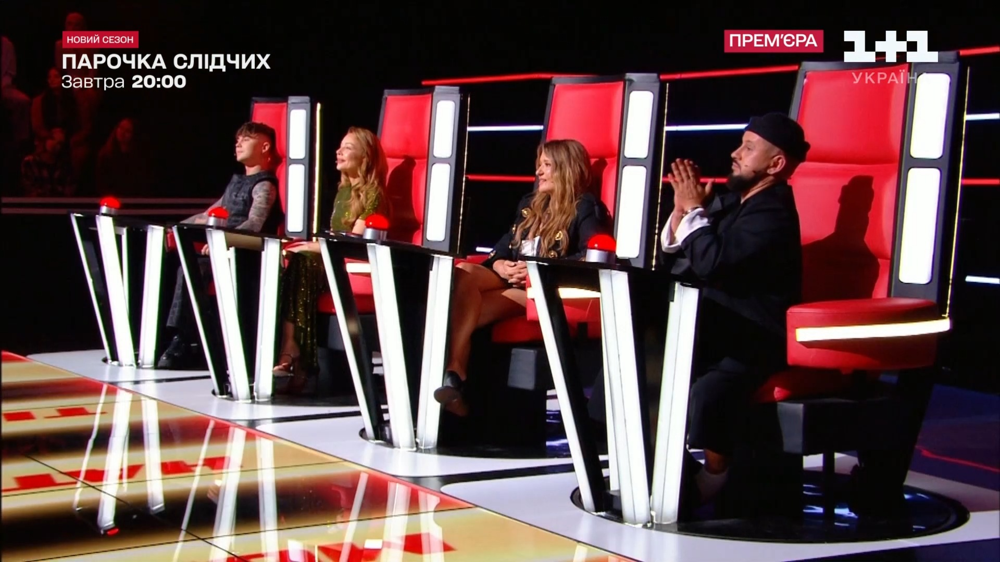
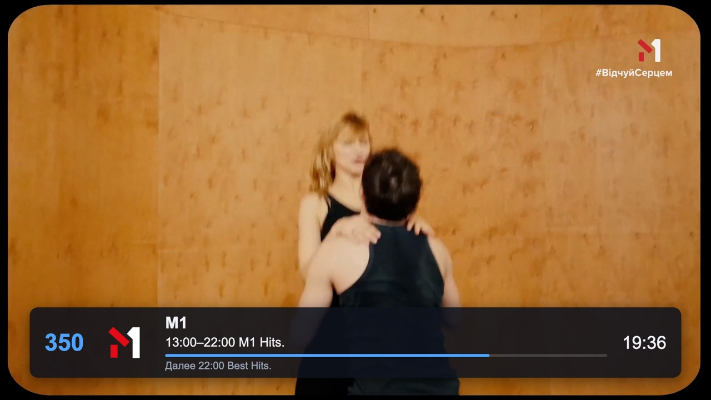
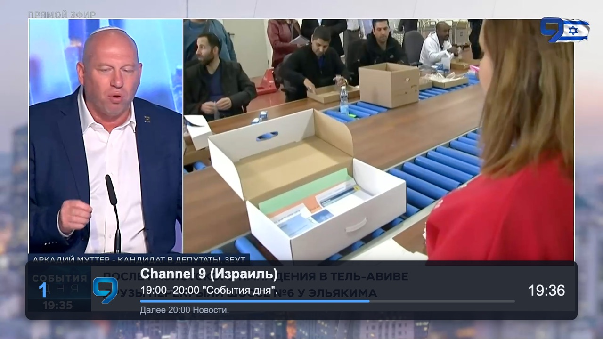
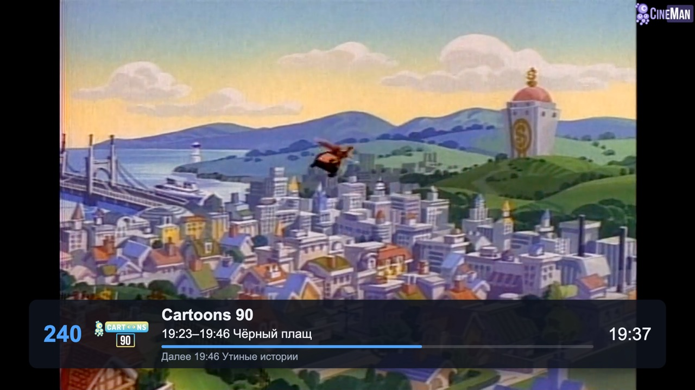
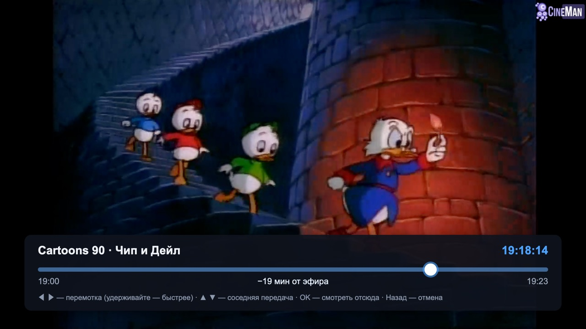
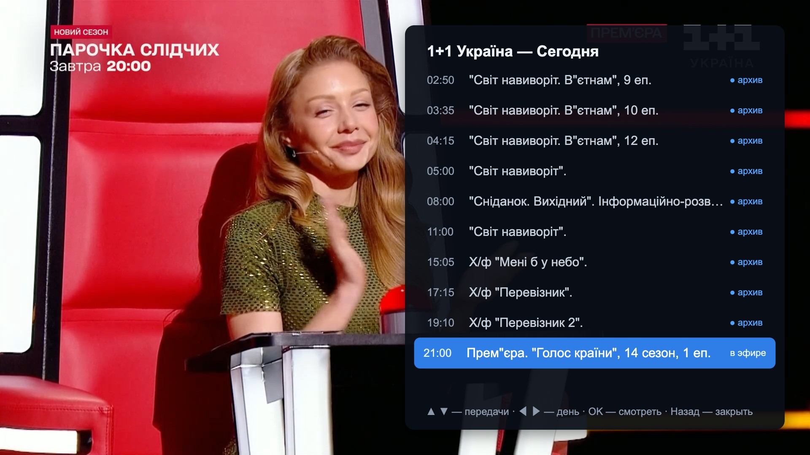
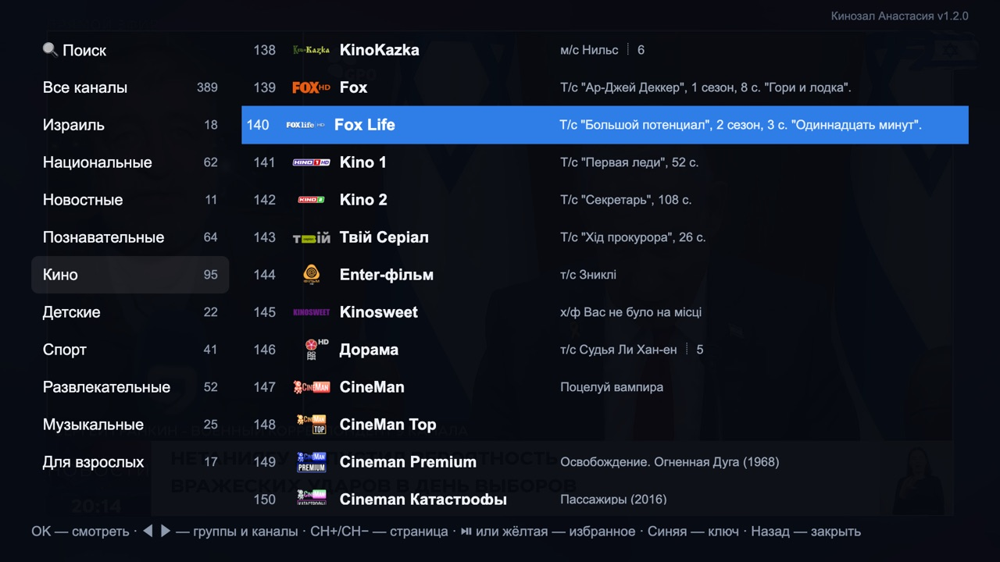
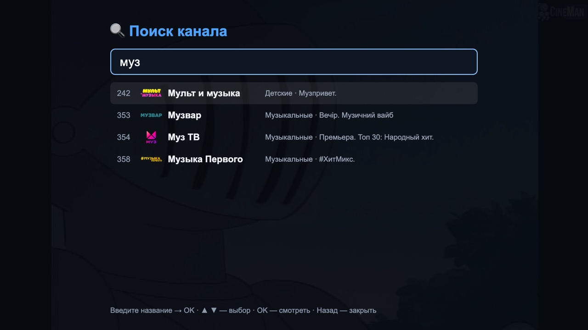

<p align="center">
  
</p>

<h1 align="center">Настин кинозал</h1>

<p align="center">
  <b>Your old Samsung TV deserves a cinema that never freezes.</b><br>
  389 channels · 7‑day archive with a real timeline slider · zero stalls in 30 minutes of film playback.
</p>

<p align="center">
  <i>💐 Dedicated to my wife, Anastasia.<br>
  So that in her free time she can switch on the TV, rest, enjoy life and simply have a wonderful time.</i>
</p>

<p align="center">
  
  
  
  
</p>

<p align="center">
  
</p>

---

## ▶ Turn your TV into a cinema tonight

That 2017 Samsung on your wall still has a great panel. Its apps don't. Menus throw JavaScript errors, channels freeze, and nothing gets updated any more.

**Настин кинозал (Nastin Kinozal) fixes that in one install.** It is a player written for the web engine your TV actually has, and it plays through the TV's own hardware decoder. Everything you open is fast, and every stream heals itself.

**[⬇ Install it on your TV](#-install) · [⭐ Star the repo](https://github.com/yaroslavrudenko/nastin-kinozal) · [💬 Tell us your TV model](https://github.com/yaroslavrudenko/nastin-kinozal/issues)**

---

> **This is a player, not a TV service.** Настин кинозал shows no channels by itself. You need **your own paid IPTV subscription**: it was built for [OTT Club](https://www.ottclub.tv) and has first-class support for it, and it also plays **any provider's M3U playlist** ([see below](#-use-it-with-any-iptv-provider)). No channels, keys or playlists are included in this repository.

## Why you'll love it

| | |
|---|---|
| 🎬 **Films never stop** | Hardware H.264 decoding, a 10‑second safety buffer, and a watchdog that reconnects a stalled stream on its own. Measured: three movie channels for 10 minutes each, **0 stalls, 0 rebuffers, 0 reconnects**. |
| ⏪ **Rewind TV like a video** | Press ▲ while watching and a timeline slider appears. Hold ◀ ▶ to scrub (it speeds up as you hold), jump between shows with ▲ ▼, and press OK to watch from that moment. Up to 7 days back. |
| 🔍 **Find any channel** | Type part of a name (or a number) in 🔍 Search at the top of the menu; results update as you type. |
| 📺 **Every channel, in order** | The full live list of **389 channels** from the provider, with 🇮🇱 Israel and 🇺🇦 Ukraine groups: Israel first, then National, News, Documentary, Movies, Kids, Sport and more. The list is fetched fresh on every start. Channels the provider removed are hidden automatically. |
| ★ **Your own favourites** | Press ⏯ (or Yellow) on any channel to pin it to ★ Favourites. CH+/CH− inside Favourites zaps through favourites only. |
| ⚡ **Instant on old hardware** | Virtualised lists keep a 1000‑channel playlist as fast as a 10‑channel one. The programme guide loads per channel, only when you look at it. |
| 🔊 **Picture and sound under control** | Every channel switch shows the stream briefly: resolution, codec, bitrate and sound (for example `1920×1080 · H264 · 7,5 Мбит/с · звук стерео`). Choose the audio track and the picture mode (auto, full screen or letter‑box). |

## See it in action

### Channels

<table>
  <tr>
    <td></td>
    <td></td>
  </tr>
  <tr><td align="center"><b>М1</b> · Ukrainian music</td><td align="center"><b>Nat Geo Wild</b> · wildlife</td></tr>
  <tr>
    <td></td>
    <td></td>
  </tr>
  <tr><td align="center"><b>Channel 9</b> · Israel, news</td><td align="center"><b>Cartoons 90</b> · cartoons of the 90s</td></tr>
  <tr>
    <td></td>
    <td></td>
  </tr>
  <tr><td align="center"><b>Discovery</b> · documentary</td><td align="center"><b>Cartoons Short</b> · classic animation</td></tr>
</table>

### The player

<table>
  <tr>
    <td></td>
    <td></td>
  </tr>
  <tr><td align="center"><b>▲ Archive slider</b>: scrub to any minute</td><td align="center"><b>▼ Programme</b>: past shows play from the archive</td></tr>
  <tr>
    <td></td>
    <td></td>
  </tr>
  <tr><td align="center"><b>OK · Channel menu</b>: groups, logos, what's on</td><td align="center"><b>🔍 Search</b>: results as you type</td></tr>
</table>

## Remote control

The player works with the basic Samsung Smart Remote. No number or colour keys are needed.

| Key | While watching | In the guide |
|---|---|---|
| ◀ ▶ | previous / next channel | switch column |
| ▲ | archive slider: scrub to any minute | move up |
| ▼ | this channel's programme: ◀ ▶ change the day, OK watches | move down |
| OK | the channel menu with 🔍 Search | watch the channel or the show (the channel already on screen is not restarted) |
| ⏯ | pause / play | add or remove a favourite |
| ⏪ ⏩ | archive slider, big steps | — |
| CH+ / CH− | next / previous channel | archive day, or page through channels |
| Back | back to live; press twice to exit | close |
| 0–9 · Red · Green · Blue | channel number · audio track · picture mode · stream info | — |

## Why this project exists

Samsung TVs from 2017 and 2018 still have good panels, but their software has fallen behind.

- **The official OTT Club app on these TVs is stuck at version 1.0.6.** It is a 56 KB shell that downloads its menu from the provider's server. The Android app moves on (2.6x in 2026), but the code it sends to the TV now uses JavaScript that the TV's 2015-era web engine cannot run. The result is JavaScript errors in the menus, frozen screens, and channels that hang without recovering.
- **Samsung no longer updates these TVs.** The firmware is signed and locked, so the web engine cannot be upgraded. The only fix inside the TV is an app written for the engine the TV actually has.
- **The goal: a player that is fast, reliable and complete on old hardware.** It keeps every feature that matters to a viewer: all channels split into groups, a programme guide, a 7-day archive with rewind, sound tracks and picture modes. The app should never hang. A stalled stream reconnects by itself, and the interface stays responsive with a thousand channels.

The app is named after the person it was made for: «Настин кинозал» means "Nastya's cinema", a cinema at home, one that simply works.

## Design principles

- **Native playback first.** Video is decoded by the TV's hardware player (AVPlay), not in JavaScript.
- **Never block the UI.** Lists are virtualised, and the guide loads one channel at a time.
- **Assume the network fails.** Every stall, error or network drop leads to an automatic reconnect with backoff (0.5 s up to 15 s).
- **Never show a stale list.** Channels come from the provider on every start, and each one is re-checked in the background.
- **Write for the oldest engine.** The code is plain ES5, checked with `acorn --ecma5`, and needs no build step.

## Measured, not promised

| Check | Result |
|---|---|
| Movie channels, 3 × 10 min in parallel | 0 stalls · 0 rebuffers · 0 reconnects · buffer never below 12 s |
| Playback on the TV (UE50MU7000, Tizen 3.0) | hardware H.264 1920×1080, ~6 Mbit/s, `PLAYING` |
| Channel list request | ~0.1 s, 389 channels, 9 groups |
| Archive depth | 7 days; every hour complete |
| Archive on the TV (programme panel, slider) | first frame in 2.2 s; 60 s without a single failure |
| Archive that catches up with live | continues by itself, no "no signal" |
| Full channel re-check | 389 channels in ~9 s, in the background |

Open performance issues and every performance change, with before/after numbers: **[docs/PERFORMANCE.md](docs/PERFORMANCE.md)**.

## ⚡ Performance

In October 2026 six independent reviewers went through the whole player. The 230 findings were then fixed over six reviewed iterations, and 159 behaviour tests now guard the fixes.

On the TV (2026-10-25/26) the build passes the life-cycle test: close, open, exit and reopen, and Home → another app → back, twice. The heaviest movie channel, Viju+ Megahit at 1080p and 10.9 Mbit/s, plays without stalls. The acceptance plan is in [docs/TESTING.md](docs/TESTING.md).

**TV run of 2026-10-26** (automated runner `tests/tv/run.mjs`, builds f7ccc45 and 84fc43e): 11 channel groups, 349 channels in «Все каналы».
- **Channel list:** 0 empty «now» cells. The few rows that lagged had changed less than 60 s before (the refresh floor).
- **Zapping:** first frame on landing 0.7–2.0 s (median 1.0 s); a single zap 0.7–1.3 s; a burst of 10 presses lands right with 0 extra requests.
- **Archives:** 8 of 8 archive opens on the four heaviest movie channels play. The end of a recording continues within 2 s of the right moment. The 7-day archive edge plays (fixed in 84fc43e).
- **Stability:** 10 min without a stall; a 60 s pause sends no requests.
- **Open:** the tech-line check is being re-run, and the 60 s «now» refresh floor awaits the owner's decision.
- **Update, later on 2026-10-26:** the «now» refresh was redesigned (DEC-2026-10-26-now-refresh-2): only rows on screen ask the provider, the guide-known row turns over at its end with no request, a 10 s floor, and a row never goes blank — past 15 min without news it keeps the last programme marked «(шла до HH:MM)». Verified on the desktop; the TV run is pending ([docs/PERFORMANCE.md](docs/PERFORMANCE.md)).

Details: [docs/TESTING.md](docs/TESTING.md) (results of 2026-10-26).

The numbers below were measured on a desktop (harness and headless Chrome):

- **Zapping:** requests per 10 quick presses 20 → 3; a single press opens the channel after 0 ms instead of 350 ms.
- **Startup:** the channel list is parsed once instead of twice, with 0 storage writes before the first frame (was 2). The offline copy shrank from 500 KB to 44 KB. No long tasks over 50 ms (was 66–74 ms at 6× CPU).
- **Quiet when idle or failing:** 0 requests during a 10-minute pause (was 200). A failing guide makes 5 requests in 10 minutes instead of 12 007.
- **Memory:** full guides kept after 100 channels 100 → 24, with no descriptions stored.

The full before → after table and what is still to verify on the TV: **[docs/PERFORMANCE.md](docs/PERFORMANCE.md#summary-of-the-2026-performance-work)**.

## 📡 Use it with any IPTV provider

**OTT Club** (built-in): enter your subscriber key when the app starts for the first time, or put `OTT_KEY=` into `build.local.env`. The channels, groups, logos, the 7-day guide and the archive then come from OTT Club directly.

**Any other provider**: on the first-run screen, paste your **M3U playlist URL** instead of a key, or build it in with `PLAYLIST_URL=` in `build.local.env`. Typing a long URL with a TV remote is slow, so building it in is easier. From a standard extended M3U the player takes:

| Playlist attribute | What it gives you |
|---|---|
| `group-title` / `#EXTGRP` | the groups in the menu |
| `tvg-logo`, `tvg-id` | logos; programme guide matching |
| `url-tvg` / `x-tvg-url` in `#EXTM3U` | the programme guide (XMLTV, uncompressed) |
| `catchup`, `catchup-source`, `catchup-days` (or `tvg-rec`, `timeshift`) | the archive and the slider: `default` / `append` templates (`{utc}`, `{lutc}`, `{start}`, `{end}`, `{duration}`, `{offset}`, `{Y}{m}{d}{H}{M}{S}`), `shift` (`?utc=…&lutc=…`) and `flussonic` |

Without catch-up attributes, live TV, groups, favourites and search still work; only the archive is missing.

**🇮🇱 Israel and 🇺🇦 Ukraine groups work with any provider.** A channel's country is recognised from a tag in the name (`(Израиль)`, `IL:`, `[UA]`, `… UA`), the playlist group (`Israel`, `Україна` …), the guide id (`tvg-id` ending in `.il` / `.ua`), Hebrew or Ukrainian text in the name or the show on air, and a list of well-known channel names (`js/country.js`). Israeli channels also open the list, with Channel 9 first.

## 🚀 Install

**[docs/DEPLOY.md](docs/DEPLOY.md) is the full guide**, written from a real install. It covers Developer Mode, the Tizen CLI on Apple Silicon, the macOS local-network trap, Samsung certificates without the broken Certificate Manager, and the **device profile without which every install fails with `118`**.

In short:

```sh
sdb connect <tv-ip>:26101 && sdb shell 0 getduid             # the TV's DUID
node tools/samsung-cert.mjs --duid <DUID> --name kinozal     # sign in to Samsung once; certificates + device profile
printf 'CERT_PROFILE=kinozal\nDEVICE_PROFILE=%s\nTV=<tv-ip>:26101\n' ~/tizen-studio-data/keystore/kinozal/device-profile.xml > build.local.env
./build.sh                                                   # sign, push the device profile, install, start
```

The daisy icon appears in your TV's apps.

## 🗺 Roadmap

**A universal player for any provider**
- [ ] A setup screen to pick the source: any M3U/M3U8 playlist URL, Xtream Codes (server + login), and possibly Stalker/MAG portals.
- [ ] Programme guide (XMLTV) by URL, independent of the playlist.
- [ ] Catch-up formats (`flussonic`, `shift`, templates) always taken from the playlist itself.
- [ ] OTT Club becomes one built-in preset instead of the default.
- Builds on what is already here: `js/m3u.js`, `js/epg.js`, `js/catchup.js` and the provider-independent 🇮🇱 Israel / 🇺🇦 Ukraine grouping in `js/country.js`.

**Publish in the Samsung TV app store** (Samsung Apps, via Tizen Seller Office)
- [ ] No built-in provider or channels: users bring their own subscription.
- [ ] A privacy policy.
- [ ] Store icons and screenshots.
- [ ] Pass Samsung certification on several TV generations.

**Ideas: more providers and platforms**
- [ ] Enter the playlist from a phone by scanning a QR code on the TV.
- [ ] An LG webOS port.
- [ ] An Android TV build.
- [ ] Settings backup and restore.

---

<p align="center">
  <b>Made with love for Настя: a cinema at home, one that simply works.</b><br>
  If it brought your old TV back to life, <a href="https://github.com/yaroslavrudenko/nastin-kinozal">give it a ⭐</a>.
</p>
- Test report 2026-10-26: [docs/TEST-REPORT-2026-10-26.md](docs/TEST-REPORT-2026-10-26.md)
