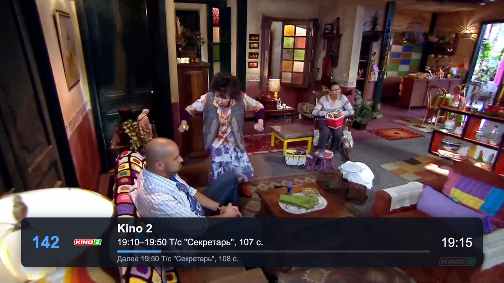
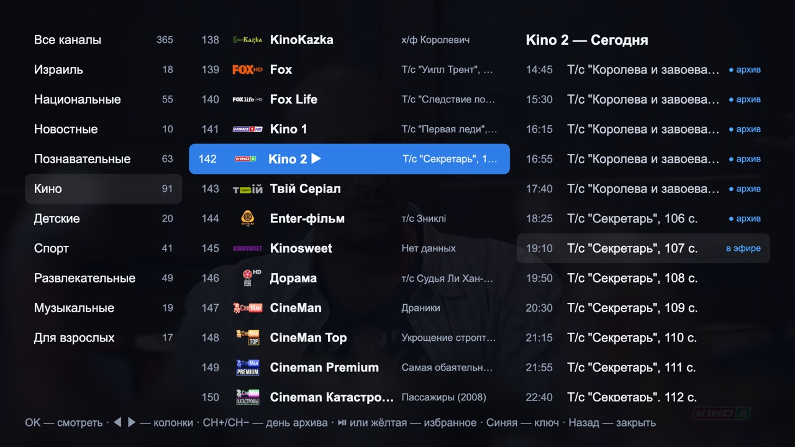
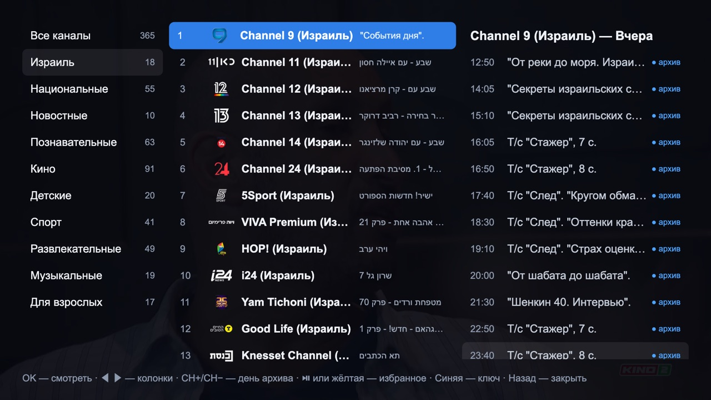
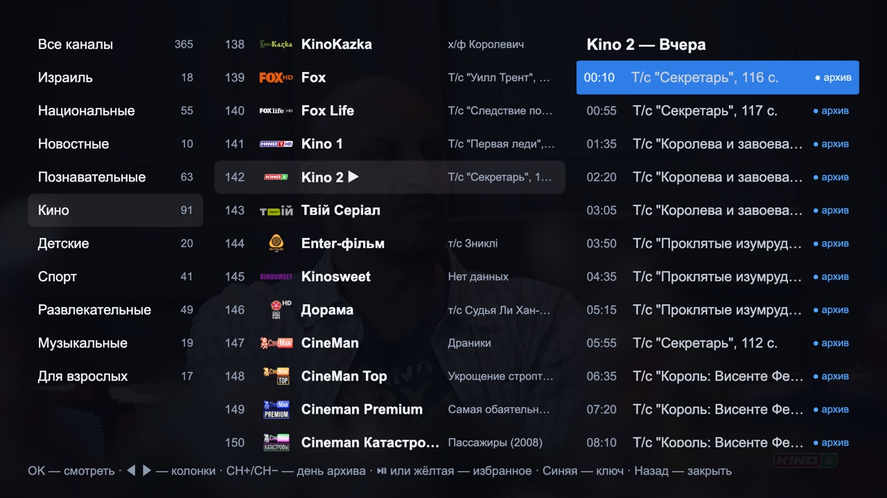

<p align="center">
  
</p>

<h1 align="center">Кинозал Анастасия</h1>

<p align="center">
  <b>Your old Samsung TV deserves a cinema that never freezes.</b><br>
  389 channels · 7‑day archive with a real timeline slider · zero stalls in 30 minutes of film playback.
</p>

<p align="center">
  
  
  
  
</p>

<p align="center">
  
</p>

---

## ▶ Turn your TV into a cinema tonight

That 2017 Samsung on your wall still has a great panel. Its apps don't. Menus throw JavaScript errors, channels freeze, and nothing gets updated any more.

**Кинозал Анастасия fixes that in one install.** It is a player written for the web engine your TV actually has, and it plays through the TV's own hardware decoder. Everything you open is fast, and every stream heals itself.

**[⬇ Install it on your TV](#-install-in-10-minutes) · [⭐ Star the repo](https://github.com/yaroslavrudenko/kinozal-anastasia) · [💬 Tell us your TV model](https://github.com/yaroslavrudenko/kinozal-anastasia/issues)**

---

## Why you'll love it

| | |
|---|---|
| 🎬 **Films never stop** | Hardware H.264 decoding, a 10‑second safety buffer, and a watchdog that reconnects a stalled stream on its own. Measured: three movie channels for 10 minutes each, **0 stalls, 0 rebuffers, 0 reconnects**. |
| ⏪ **Rewind TV like a video** | Press ▼ while watching and a timeline slider appears. Hold ◀ ▶ to scrub (it speeds up as you hold), jump between shows with ▲ ▼, and press OK to watch from that moment. Up to 7 days back. |
| 📺 **Every channel, in order** | The full live list of **389 channels** from the provider: 🇮🇱 Israel first, then National, News, Documentary, Movies, Kids, Sport and more. The list is fetched fresh on every start. Channels the provider removed are hidden automatically. |
| ★ **Your own favourites** | Press ⏯ (or Yellow) on any channel to pin it to ★ Favourites. CH+/CH− inside Favourites zaps through favourites only. |
| ⚡ **Instant on old hardware** | Virtualised lists keep a 1000‑channel playlist as fast as a 10‑channel one. The programme guide loads per channel, only when you look at it. |
| 🔊 **Picture and sound under control** | Choose the audio track, the picture mode (auto, full screen or letter‑box) and see the live resolution and bitrate. |

## See it in action

<table>
  <tr>
    <td></td>
    <td></td>
  </tr>
  <tr>
    <td align="center"><b>Groups, channels and today's programme</b></td>
    <td align="center"><b>Archive slider: scrub to any minute</b></td>
  </tr>
  <tr>
    <td></td>
    <td></td>
  </tr>
  <tr>
    <td align="center"><b>Israeli channels first</b></td>
    <td align="center"><b>Yesterday, the day before… a week of archive</b></td>
  </tr>
</table>

## Remote control

The player works with the basic Samsung Smart Remote. No number or colour keys are needed.

| Key | While watching | In the guide |
|---|---|---|
| ◀ ▶ | previous / next channel | switch column |
| ▲ | this channel's programme and archive | move up |
| ▼ | archive slider | move down |
| OK | open the guide | watch the channel or the show |
| ⏯ | pause / play | add or remove a favourite |
| ⏪ ⏩ | archive slider, big steps | — |
| CH+ / CH− | next / previous channel | archive day, or page through channels |
| Back | back to live; press twice to exit | close |
| 0–9 · Red · Green · Blue | channel number · audio track · picture mode · stream info | — |

## Why this project exists

Samsung TVs from 2017 and 2018 still have good panels, but their software has fallen behind.

- **The official OTT Club app on these TVs is stuck at version 1.0.6.** It is a 56 KB shell that downloads its menu from the provider's server. The Android app moves on (2.6x in 2026), but the code it sends to the TV now uses JavaScript that the TV's 2015-era web engine cannot run. The result is JavaScript errors in the menus, frozen screens, and channels that hang without recovering.
- **Samsung no longer updates these TVs.** The firmware is signed and locked, so the web engine cannot be upgraded. The only fix inside the TV is an app written for the engine the TV actually has.
- **The goal: a player that is fast, reliable and complete on old hardware.** It keeps every feature that matters to a viewer: all channels split into groups, a programme guide, a 7-day archive with rewind, sound tracks and picture modes. The app should never hang. A stalled stream reconnects by itself, and the interface stays responsive with a thousand channels.

The app is named after the person it was made for: a cinema at home, one that simply works.

## Design principles

- **Native playback first.** Video is decoded by the TV's hardware player (AVPlay), not in JavaScript.
- **Never block the UI.** Lists are virtualised, and the guide loads one channel at a time.
- **Assume the network fails.** Every stall, error or network drop leads to an automatic reconnect with backoff (0.5 s up to 15 s).
- **Never show a stale list.** Channels come from the provider on every start, and each one is re-checked in the background.
- **Write for the oldest engine.** The code is plain ES5, checked with `acorn --ecma5`, and needs no build step.

## Measured, not promised

| Check | Result |
|---|---|
| Movie channels, 3 × 10 min in parallel | 0 stalls · 0 rebuffers · 0 reconnects · buffer never below 12 s |
| Playback on the TV (UE50MU7000, Tizen 3.0) | hardware H.264 1920×1080, ~6 Mbit/s, `PLAYING` |
| Channel list request | ~0.1 s, 389 channels, 9 groups |
| Archive depth | 7 days; every hour complete |
| Full channel re-check | 389 channels in ~9 s, in the background |

## 🚀 Install in 10 minutes

You need a Samsung Tizen TV, a Mac or PC on the same network, and an OTT Club subscription key. The key is entered on the TV the first time the app starts, so it is never stored in this repository.

1. **Enable Developer Mode on the TV.** Apps → press `1 2 3 4 5` → On, and enter your computer's IP address. Restart the TV.
2. **Install the Tizen CLI** (`web-cli_Tizen_SDK_*`). On Apple Silicon, install Rosetta first.
3. **Get a Samsung certificate for your TV.** Sign in with your Samsung account and request an author and a distributor certificate for your TV's DUID (`sdb shell 0 getduid`). Keep the `device-profile.xml` that Samsung returns with the distributor certificate. **Without it on the TV, every install fails with `install failed[118]`.**
4. **Create `build.local.env`:**
   ```sh
   CERT_PROFILE=<your tizen security profile>
   DEVICE_PROFILE=<path to device-profile.xml>
   TV=<tv-ip>:26101
   ```
5. **Build, sign and install:**
   ```sh
   ./build.sh
   ```

The script packages the app, pushes the device profile, installs the app with `vd_appinstall` and starts it. The daisy icon appears in your TV's apps.

---

<p align="center">
  <b>Made with love for Настя: a cinema at home, one that simply works.</b><br>
  If it brought your old TV back to life, <a href="https://github.com/yaroslavrudenko/kinozal-anastasia">give it a ⭐</a>.
</p>
